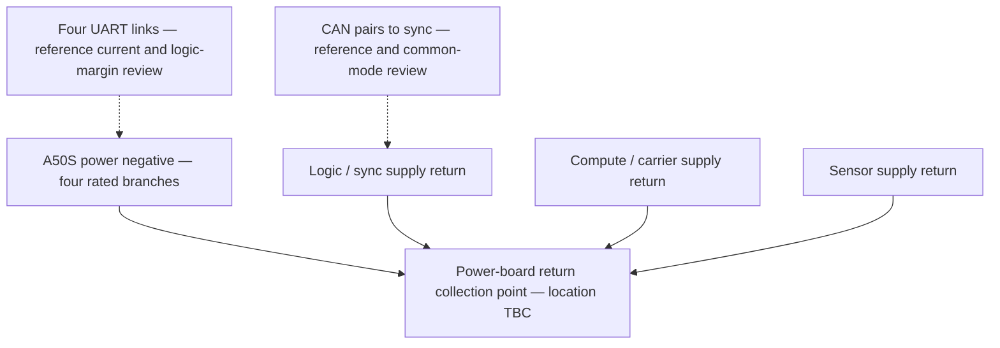

# ADR-0042: Ground returns and communication isolation

- **Status:** Proposed (for kunshpreet's design review; not a released grounding decision)
- **Date:** 2026-10-08
- **Deciders:** kunshpreet
- **Traces to:** SYS-05, SYS-19, SYS-24, SYS-31, ADR-0034, E-30, E-41, E-50, RSK-03, RSK-12
- **Issues:** [#94](https://github.com/Autonomous-Robotics-Carleton/arc-monorepo/issues/94), [#115](https://github.com/Autonomous-Robotics-Carleton/arc-monorepo/issues/115)

## Context

The drive controllers return motor current to the power board while sync, carrier and sensors have low-voltage supply returns. Adding a thin signal-ground connection between those branches creates another current path. ADR-0034 selects four single-ended 3.3 V UART links. Their receiver thresholds are sensitive to controller-to-sync ground offset; the return/reference, protection and isolation decisions remain deferred by the owner. Classic commands and steering FD also retain their common-mode limits.

Four UART harnesses must not join the controllers’ output supplies or create a second motor-current return through signal/reference conductors. Bench USB, PSU earth, Ethernet shields, mounting hardware and the proposed Aux feeds must be included in the return-path inventory.

## Options

| Option | Benefit | Limitation |
| --- | --- | --- |
| **A. Controlled power-return star, non-isolated communications** | Retains the existing non-isolated transceiver recommendation and A50S classic CAN; fewest new power domains | Requires a verified low-impedance return map and measured signal/common-mode margins; no claim of galvanic isolation |
| B. Galvanically isolated communications at the logic/drive boundary | Breaks communication return paths and improves immunity to domain offset | Needs an isolated bus-side supply or a separately referenced supply, different footprints and timing review. Every other crossing, including UART, ESTOP, Aux, USB and steering FD, must be checked for a bypass |
| C. Distributed return / extra ground wires without a current-path design | Convenient harness assembly | Uncontrolled parallel return paths; not a justified proposal for motor-current noise |

## Proposed decision

**Recommend option A for the review baseline**, with option B retained as a fully designed alternative if the return map or motor-bench margins fail. Acceptance and layout release require kunshpreet's review; this ADR does not silently select a new transceiver or isolation boundary.

1. Establish a documented return collection point on the power board near motor distribution. Each A50S has its own adequately rated positive/negative power branch. Logic / sensor / compute load returns use their own supply-return route to that collection point. Exact copper, gauge, connector and shunt placement are **TBD** from peak loads and the power schematic.
2. Do not route motor current through sync/carrier/sensor ground planes, internal logic returns, UART reference leads or cable shields. A board's fast digital signals retain a continuous local reference plane; a system-level star is not permission to split a plane underneath them.
3. Each A50S UART TX/RX uses 3.3 V logic with a reviewed controller-to-sync reference. Quantify DC offset, motor-switching transients, reference current and receiver timing/noise margin at both ends. The proposed two signal/reference pairs are a wire budget, not approval to create parallel motor-current returns. Do not parallel 3.3 V / 5 V controller outputs.
4. Classic command CAN and steering FD reference the reviewed supply-return network. Final CAN-reference conductor population / impedance network is **TBC**; validate common-mode range, EMI and loss-of-return cases with the actual harness.
5. Keep shields separate from functional supply returns. Shield-to-chassis / mounting bonds are **TBD**; record intentional bonds and exclude accidental ones. Keep power branches / phase leads away from signal pairs and Hall extensions. Route CAN as a twisted pair with short transceiver taps, per ADR-0019 / ADR-0034.
6. Retain TJA1462AT-class FD and TJA1051-class classic transceivers as the existing **non-isolated candidates**, subject to exact-suffix review. SIC improves signal behavior; it does not provide galvanic isolation. Only the steering FD link remains; qualify its recorded 1 / 5 Mbit/s baseline separately.
7. Four permanent UART links are now the operating drive telemetry path. Harness length, pairing, reference population, damping/protection and power-off behavior are **TBD**. If single-ended margins fail, review an isolation or line-interface implementation with the owner; no isolator/buffer or altered voltage standard is selected here.

This is a return-path proposal, not a released schematic. Termination is across the CAN pair; its split capacitor reference follows the reviewed local transceiver domain. The diagram does not settle the bus-clamp position or independent-brake topology.

## Isolation alternative

TI ISO1042 supports CAN-FD up to 5 Mbit/s, with separate logic-side and bus-side supplies/grounds. It is an **evaluation candidate**, not an SO-8 drop-in for TJA1462/TJA1051: verify package and pinout. An isolation design must power and reference both sides, retain the barrier through PCB copper / shielding, budget propagation delay / transmitter-delay compensation and qualify the bus at 5 Mbit/s.

Isolating only one link does not isolate the car if another direct ground connection bypasses it. Decide the complete boundary, including command CAN, all four UARTs, steering FD, ESTOP, Aux and USB. CAN isolation parts do not isolate UART. The UART isolator/channel direction, supplies, startup states and propagation timing remain TBD; do not order isolated parts or claim an isolated controller domain until the complete boundary is reviewed.

## Evidence and release criteria

Use [ground-return bench checks](../tests/grounding-and-signal-integrity.md). Record the return map and calculate branch voltage drop as I × R from measured harness resistance / actual peak current; no unmeasured resistance or invented allowable offset is baselined. Measure DC offset and switching transients at each communicating endpoint, check the selected parts' recommended operating / absolute-maximum ranges with a documented margin, and verify the required bus rate and error logs under load. Fault/power-state testing must include unexpected parallel paths and unpowered nodes.

Only after those checks and design approval may the ICD ground/reference rows and transceiver population become baselined. #94 / #115 remain open until their owner-approved grounding / harness decision is recorded; this proposal completes the review package, not hardware qualification.

Primary sources: [NXP TJA1462](https://www.nxp.com/docs/en/data-sheet/TJA1462.pdf), [TI ISO1042](https://www.ti.com/lit/ds/symlink/iso1042.pdf), [ST STM32F405](https://www.st.com/resource/en/datasheet/stm32f405rg.pdf), and the [A50S UART readiness review](../reviews/a50s-uart-readiness.md).
