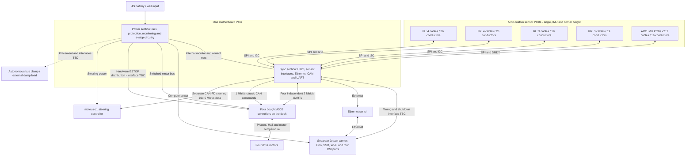

# Motherboard wiring and remote sensor boards

- **Status:** Draft. Proposed wiring budget (TBC); connector pinouts are not released.
- **Date:** 2026-10-09

This accompanies the [parts decision list](pcb-parts-selection.md). Power and sync MCU share one motherboard; the Jetson carrier stays separate (ADR-0044). Motor temperature reaches each A50S from the motor's sensor cable, or from an E-28 thermistor on the can. The sensor inventory is ten angle (four wheel, four suspension, two front knuckle), two IMU and five ToF boards, all assembled in house (ADR-0052).

## Board and harness diagram

Each sensor bank below groups separate cable runs. Counts are the proposed sensor-harness minimum, TBC; other connections and additional returns are specified in the schedules below.

This is a functional connection map, not a connector pinout or a released e-stop circuit. Four camera CSI interfaces belong to the carrier; their FFCs do not enter the motherboard sensor banks.

## What the wire counts mean

The current SPI-angle / I²C-mux sensor proposal needs **17 remote sensor cable runs, with a minimum budget of 111 conductors entering the motherboard: 94 used + 17 spares**. This is a **TBC lower bound for the sensor harnesses**, not the complete board wiring total, MCU pin count or a released connector pinout. Additional return contacts, shields, reset/sync/interrupt lines and level translation can increase it. Exact connector sizes, pin ordering, wire gauge, lengths and MCU pin assignments are TBD.

Count each cable's physical conductors, even when SPI signals share MCU peripherals. A connector's unused contacts do not count as a spare wire unless the cable actually includes that conductor. The spare-per-run convention is recorded in [architecture](../architecture.md#harness); sensor quantities/interfaces come from E-20, E-21, E-22, E-23, E-24 and E-26 under ADR-0052 and SYS-06, SYS-07, SYS-10 and SYS-24.

## Sensor cable budget at the motherboard

| Sensor / cable type | Installed runs | Used conductors per run | Spare per run | Minimum conductors per run, TBC | Total, TBC | Trace |
| --- | --- | --- | --- | --- | --- | --- |
| Wheel angle | 4 | 6: sensor supply, GND, SCK, MOSI, MISO, dedicated CS | 1 | 7 | 28 | E-22, SYS-06 |
| Suspension angle | 4 | Same SPI set | 1 | 7 | 28 | E-23, SYS-06 |
| Front knuckle angle | 2 | Same SPI set | 1 | 7 | 14 | E-24, SYS-06, SYS-24 |
| CG and front IMUs | 2 | 7: sensor supply, GND, SCK, MOSI, MISO, CS, DRDY | 1 | 8 | 16 | E-20, E-21, SYS-06, SYS-07 |
| Ride-height ToF | 5 | 4: sensor supply, GND, SCL, SDA | 1 | 5 | 25 | E-26, SYS-10, ADR-0052 |
| **Sensor-only total** | **17** | **94 used overall** | **17 overall** | — | **111 minimum** | Proposed wiring for the sensor inventory under ADR-0052 |

This budget uses AS5047-family suspension sensing and the proposed motherboard TCA9548 mux, **one ToF per mux channel**; retain at least one spare mux channel. The mux's upstream I²C stays on the motherboard; each downstream channel gets its own remote cable. Remote XSHUT is not counted in this minimum: its startup/reset handling must be designed and reviewed. Add conductors if remote XSHUT, ToF interrupt, IMU reset/sync, extra power/reference or the final sensor requires them. The ELPM alternative is not included; accepting it would replace four SPI cable budgets with a reviewed analog interface.

## Sort the harness by measurement location

Use these **proposed connector-bank labels**, not invented pin numbers. Each sensor has its own cable/CS or mux channel; grouping a loom does not join chip-selects or short separate I²C channels together.

| Motherboard bank / loom | Remote destinations | Separate cable runs | Minimum conductors at bank, TBC |
| --- | --- | --- | --- |
| FL | Wheel angle 7 + suspension angle 7 + knuckle angle 7 + ride-height ToF 5 | 4 | 26 |
| FR | Wheel angle 7 + suspension angle 7 + knuckle angle 7 + ride-height ToF 5 | 4 | 26 |
| RL | Wheel angle 7 + suspension angle 7 + ride-height ToF 5 | 3 | 19 |
| RR | Wheel angle 7 + suspension angle 7 + ride-height ToF 5 | 3 | 19 |
| IMU | CG IMU 8 + front IMU 8 | 2 | 16 |
| Ground camera | Scale ToF 5, beside the downward camera | 1 | 5 |
| **Total** | **17 measurement sites** | **17** | **111** |

Route each location's sensor loom separately from motor phases and high-current power. Label both cable ends by location, function and net; provide locking connectors and strain relief. Preserve corner service disconnects without moving sensor acquisition into the motor controller (ADR-0008). Qualification decides bus partitioning, return geometry, SCK rate, damping and allowable length; the count alone does not prove SPI/I²C operation in the installed harness.

## Custom remote sensor PCBs

**ADR-0052: all seventeen sensor boards are our own and assembled in house.** Build ten AS5047P angle boards (four wheel, four suspension and two front knuckle), two ISM330DHCXTR IMU boards and five ToF boards (four corners plus one beside the downward camera). Order bare PCBs and loose chips/support parts separately; no JLC sensor assembly is budgeted. The model has **three sensor PCB designs / 17 populated sensor boards**. Common 2-layer implementations, physical outlines, mechanical variants and exact connectors remain TBC/TBD; none has a released schematic. See the [in-house assembly purchase plan](../../hardware/sensor-boards/README.md#as5047p-in-house-purchase-and-assembly-plan).

Each carrier holds the actual sensing IC, its specified local decoupling, reviewed bias/reset/address straps, protection and a locking cable connector. Angle carriers need the reviewed magnet/shaft geometry; IMU carriers need the specified vibration mounts; ToF carriers need a clear optical aperture and the cover-window/recess checks. Use a continuous signal-return region where practical; connector returns and grounding remain subject to ADR-0042. Pull-up placement is reviewed for each mux channel rather than copied blindly onto every board.

These are **sensor carriers without a local MCU or CAN node**. SPI/I²C returns directly to the H723 on the motherboard, preserving ADR-0006 / ADR-0008. Keep the Hall/temperature cable to each A50S separate. The design workspaces are [sensor overview](../../hardware/sensor-boards/README.md), [custom IMU PCB](../../hardware/sensor-boards/imu/README.md) and [custom corner-height PCB](../../hardware/sensor-boards/tof/README.md). Verify assembled harness timing/noise under SYS-06 / SYS-07 before approving 2-layer fabrication.

## Other motherboard connections

These figures are **functional wire budgets, TBC**, unless the existing ICD already specifies the interface. They exclude connector duplication, extra rated returns, shields and unresolved spare-policy implementation. **The complete motherboard conductor and connector total remains TBD** until the open interfaces below are designed; 111 must not be used as that total.

| Connection | Physical routing | Functional conductors / cable budget | Remaining release work / trace |
| --- | --- | --- | --- |
| Battery main feed | Pack → loop key / protection → motherboard | 2 power conductors | Gauge, current rating, protection and spare implementation TBD; E-40, E-42, SYS-03, SYS-05 |
| Battery balance | 4S pack → cell monitor on motherboard | 5 taps: B0 through B4 | Fuse/filter, off-state drain and connector review; E-46, SYS-19, SYS-32 |
| Wall input | Brick → motherboard ORing | 2 power conductors | Exact brick, input protection and connector TBD; E-44, SYS-14 |
| Compute power | Motherboard → separate Jetson carrier | 2 power conductors minimum | Additional current-carrying contacts/returns and switched branch TBD; E-02, SYS-30, SYS-31 |
| Carrier timing / shutdown | Motherboard ↔ carrier / camera trigger routing | TBC minimum 9: four trigger signals, PPS, shutdown request, halt acknowledgement, reference + one trigger/run spare | Handshake remains proposed; levels, return contacts and actual paths TBD in [carrier-sync](../icd/carrier-sync.md); SYS-07, SYS-30 |
| Sync Ethernet | Motherboard PHY → E-06 switch | One standard 8-conductor Ethernet cable | This is a PHY/magnetics cable, not eight MCU GPIOs. Separate carrier and LiDAR Ethernet cables also go to the switch; SYS-08, SYS-29 |
| A50S motor-bus power | Motherboard switched output → E-45 distribution → four A50S | 2 per controller branch; motherboard-to-distributor harness TBD | Current-rated conductors, topology and connectors TBD; E-45, E-50, SYS-05 |
| A50S telemetry UARTs | Each A50S USART3 ↔ assigned H723 UART on motherboard | Per A50S: TX/reference pair + RX/reference pair + one spare = minimum 5, TBC; four runs = 20 | 2 Mbit/s 8N1, 3.3 V logic; actual contacts, H723 DMA/pins and return/isolation/protection design TBD (ADR-0034) |
| Classic motor-command CAN and ESTOP | Motherboard / deck loom ↔ four A50S | CAN differential pair and hardware ESTOP distribution; physical total TBD | Trunk topology/reference and independently driven stop routing TBD; [corner connector](../icd/corner-connector.md), SYS-05, SYS-25 |
| Steering | Motherboard switched power + dedicated FD bus → E-31 | Power pair + FD differential pair; reference/spares and harness total TBD | Remains a separate steering FD bus at exactly 5 Mbit/s; SYS-08, SYS-22 |
| LiDAR and switch supplies | Motherboard protected branches → E-10 / E-06 | 2 power conductors per load before additional contacts/spares | Actual switch supply TBD; rail and current qualification in [power-rails](../icd/power-rails.md), SYS-14, SYS-19 |
| E-stop button | E-32 / motherboard | **TBD** | Contacts, connector and run TBD (SYS-05, ADR-0012) |
| Lighting, off-board status LEDs, dump resistors | Motherboard / reviewed drivers / clamp → remote loads | **TBD** | Driver location, load connections and clamp placement not selected; E-29, E-33, E-43, SYS-10, SYS-14, SYS-19 |

Power/sync monitor buses and alerts are **internal PCB nets**, not an extra external stacking cable (ADR-0044). Four CSI interfaces belong on the separate carrier; camera FFCs do not enter the motherboard and are not included in the sensor count. Debug/programming leads are service connections, with header mapping TBD.

**A50S UART operating wiring:** PB10 TX / PB11 RX are the A50S's USART3 (ADR-0034). Four UART runs add a TBC 20-conductor budget, separate from the 111 remote-sensor conductors. TX/reference and RX/reference pairs need reviewed return-current paths; debug/programming leads remain separate service connections. Neither subtotal is the complete motherboard wire total. See the [UART review](../reviews/a50s-uart-readiness.md).

## Motor wiring bypasses the motherboard sensor banks

Each motor sends **three phase leads to its A50S**, plus its 6-pin Hall sensor cable: Hall A/B/C, 5 V, GND and, if the Castle has one, its thermistor. If it doesn't, an E-28 thermistor on the can adds one lead sharing the cable's ground; meter the sensor port on arrival. Controller supply outputs must not be paralleled. Motor temperature adds **zero direct motherboard sensor runs**; it arrives in controller telemetry.

## Before schematic/harness release

Freeze the exact sensor/motor variants and board locations; then publish a connector/contact/net/cable schedule and MCU pin map. Confirm supply/reference partitioning, remote reset/interrupt needs, ToF pull-ups and every spare. Verify installed harness behavior, acquisition timestamps and full-rate sensor reads; qualify all four A50S UARTs, the separate steering FD link and the e-stop separately. The ICD approvals and [fab gate](../reviews/fab-gate.md) still apply.

Interface references: [AS5047P manufacturer datasheet, distributor mirror](https://www.mouser.com/datasheet/2/588/asset_pdf_25493104-3419339.pdf), [ISM330DHCX datasheet](https://www.st.com/resource/en/datasheet/ism330dhcx.pdf), [VL53L4CD datasheet](https://www.st.com/resource/en/datasheet/vl53l4cd.pdf), and [A50S supplier connections](https://teamtriforceuk.com/a50s-v2/). Both IMU pin maps follow the ISM330DHCXTR datasheet (ADR-0052); the final SPI/DRDY connector assignments remain TBC.
