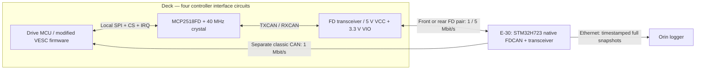

# Drive CAN-FD telemetry implementation

> [!WARNING]
> **Deprecated:** A50S drive-FD proposal withdrawn by ADR-0049. Use the active [UART ICD](controller-telemetry.md) and [UART readiness review](../reviews/a50s-uart-readiness.md). The body below is historical, not an active layout or acceptance requirement.

- **Revision:** A (2026-10-08)
- **Status:** Deprecated / historical drive-FD reference after ADR-0049
- **Side A:** drive controller firmware + local FD interface (owner kunshpreet)
- **Side B:** E-30 sync MCU, chassis harness and Orin logger (owner kunshpreet)
- **Traces to:** SYS-07, SYS-19, SYS-24, SYS-25, SYS-29, E-30, E-50, ADR-0011, ADR-0019, ADR-0041, RSK-03, RSK-12

> [!IMPORTANT]
> **5 Mbit/s data phase is a hard requirement.** Arbitration is 1 Mbit/s; FD frames use bit-rate switching. This is a bus signaling rate, not 5 Mbit/s of usable application payload. A lower rate, UART substitution or a trimmed status stream does not pass. Bought A50S controllers remain selected under ADR-0034; their FD integration and exact PCB placement remain proposed.

## Board ownership and signal path

| Assembly | Required implementation | Remaining work |
| --- | --- | --- |
| Historical custom VESC alternative | Reference only; no replacement power stage selected | Not included in the active bought-controller BOM |
| Bought A50S, E-50 ×4 | Proposed four FD circuits on the ARC main/interface PCB beside the controllers, each controlled directly by its A50S MCU over short local SPI | Exact v2.3c circuit / pin access; upstream target remains a50s_v23c_12s; MOSI and stock-clock blockers in the [source audit](../reviews/a50s-fd-feasibility.md); IRQ, Hall coexistence, rail budget and envelope TBC |
| Sync board, E-30 | Three native FDCAN channels: classic commands, front telemetry, rear telemetry; a separate populated MCP2518FD serves steering | MCU package / pin-mux, clocks, all four transceivers, protection and firmware |
| Harness | Classic command trunk; separate front and rear daisy-chained FD pairs through each local interface | Grounding, final length, contact numbering and full 5 Mbit/s test |

**Do not put the drive telemetry MCP2518FD only on the mainboard and poll stock A50S status over classic CAN.** The drive MCU must supply the actual ≥1 kHz snapshots to its local FD controller. Keep each high-clock SPI link short within the deck assembly; placing all four circuits on a shared ARC PCB is viable only if those short direct MCU connections are accessible. An H723-owned MCP2518FD polling slow stock CAN is not equivalent.

> [!IMPORTANT]
> **The source audit identifies pin and clock blockers.** SPI1 MOSI is PA7 in the selected target, while the published TX/MOSI connector position maps to PB10 in its UART definition. Stock SPI clocks give 21 or 10.5 MHz, not the proposed 20 MHz. See the [A50S feasibility audit](../reviews/a50s-fd-feasibility.md) and [arrival checks](../tests/a50s-arrival-and-fd.md). No connector-only FD wiring is released.

**Concrete resolution proposed in ADR-0043:** keep the stock clocks, use rated 10.5 MHz SPI1/DMA, verify/break out PA7 MOSI, use PB11 CS and PB10 EXTI10 IRQ. The current full-snapshot transfer-budget analysis fits a 1 kHz cycle; actual latency and motor-loop timing remain unqualified. Accepting this proposal would amend the inherited 20 MHz SPI target. Grounding and supplies remain TBD at the owner's request; the CAN-FD data rate stays exactly 5 Mbit/s.

**UART update / pin ownership:** upstream now specifies 2 Mbit/s for its legacy UART plan, but both ARC telemetry endpoints remain stubs. A50S USART3 TX/RX use PB10/PB11, so that UART cannot operate simultaneously with ADR-0043's proposed IRQ/CS on those same pads. Its calculated bandwidth does not establish FD compliance or a working bridge. Optional service-mode access remains TBD; see the [UART source review](../reviews/a50s-fd-feasibility.md#uart-update-review-2026-10-09).

## Local interface for schematic capture

| Connection | Electrical / firmware rule | Trace |
| --- | --- | --- |
| MCU SCK, MOSI, MISO, dedicated CS → MCP2518FD | 3.3 V logic; short local routing. Inherited ≥20 MHz target and component 20 MHz maximum intersect at 20 MHz, which the checked stock clock cannot produce. Resolve the clock tree or explicitly review the SPI target; never run the MCP2518FD at 21 MHz | SYS-24, RSK-12 |
| MCP2518FD interrupt → MCU interrupt GPIO | Required; dedicated usable GPIO and driver routing TBC on A50S. DMA transfers and queue work remain below the motor-control ISR priority | SYS-24, RSK-12 |
| MCP2518FD oscillator | Local 40 MHz crystal; load capacitors and tolerance from the actual oscillator design; decouple its 3.3 V rail | SYS-07, SYS-24 |
| MCP2518FD TXCAN/RXCAN → FD transceiver TXD/RXD | Existing recommended suffix: TJA1462AT, 5 V VCC / 3.3 V VIO. Wire STB for defined startup / standby behavior; verify the exact suffix and SO-8 pinout | SYS-19, SYS-24 |
| CANH/CANL → FD_IN / FD_OUT | Pass through beside the transceiver; keep these deck FD connections separate from the [corner connector](corner-connector.md), which carries motor phases and Hall wiring. Signal ground, isolation decision, TVS, choke and split termination require the final grounding / EMC review under proposed ADR-0042 | SYS-19, SYS-24, RSK-03 |

The [parts list](../bom/pcb-parts-selection.md) already prices the MCP2518FD, 40 MHz crystal and FD transceiver for four drive interfaces plus the separate steering interface. This is a proposed FD interface BOM for the bought A50S; the historical custom VESC power-stage components are not installed; exact adapter connectors, passives, power conversion, assembly and board cost remain TBD.

**Clock-tree blocker:** the checked A50S target runs SPI1 from 84 MHz APB2; supported dividers give 21 MHz (above the MCP2518FD rating) or 10.5 MHz (below the inherited proposed SPI target). Exact 20 MHz is unavailable in this stock clock tree. A clock-tree change or explicit SPI-target revision needs owner review and timing/USB/motor-loop validation. No change is selected; CAN-FD stays at mandatory 5 Mbit/s. See the [source audit](../reviews/a50s-fd-feasibility.md).

## Buses and termination

| Link | Nodes / termination | Operating rate | Traffic |
| --- | --- | --- | --- |
| Classic command trunk | Sync + four drive controllers; 120 Ω at the two trunk ends, no intermediate termination | 1 Mbit/s | Commands and low-rate health only |
| Front telemetry | Sync → FL interface → FR interface; split termination at sync and far-end harness pigtail | **1 Mbit/s arbitration / 5 Mbit/s data** | Full FL + FR snapshots at ≥1 kHz each, plus clock sync |
| Rear telemetry | Sync → RL interface → RR interface; same arrangement | **1 / 5 Mbit/s** | Full RL + RR snapshots at ≥1 kHz each, plus clock sync |
| Steering | Dedicated sync-side MCP2518FD → moteus-c1, per ADR-0019 | **1 / 5 Mbit/s** | Steering commands / replies; separate from drive telemetry |

At an intermediate deck interface, the FD pair is passed through the interface PCB; the transceiver tap is kept local (1–2 cm proposed layout target inherited from the original drive-FD design). Split termination is 2 × 60 Ω plus a capacitor whose final value is TBC. Retain the unpopulated termination / choke / TVS rework options. A50S's existing classic-CAN termination must be confirmed and removed where required; FD termination is on the added path.

Configure the external FD clock to 40 MHz and select compatible H723 FDCAN kernel-clock / bit-timing settings. Record nominal and data prescalers, segments, sample points, SJW and transmitter delay compensation in the test report. Exact register values remain TBC until the actual clock tree and harness are qualified. Identical baud rates alone do not prove suitable sample points.

## Firmware and logging sequence

1. **Drive MCU:** take a coherent snapshot of speed, motor / battery current, duty, voltage, motor / FET temperature and fault state at ≥1 kHz. Timestamp acquisition in the drive clock, aligned to the sync clock by periodic FD sync messages. Map the MCP2518FD timestamp counter to the drive MCU sample clock and measure offset / drift; the mapping algorithm is TBC. Controller receive/transmit timestamps help clock alignment; they do not replace sample time or prove SYS-07 by themselves.
2. **Packetization:** preserve the snapshot timestamp and per-corner sequence across all fragments. The current conservative [bus budget](../budgets/bus-load.csv) reserves two 64-byte FD frames per snapshot; final field map, IDs, units, scaling, fragment layout and DBC are TBD. Do not combine halves from different sample cycles.
3. **Transmit:** enqueue through DMA-driven local SPI and a lower-priority task. Log FIFO overruns, SPI faults, sequence gaps and TEC/REC / bus-off. Prove that motor-control timing remains within its existing requirements; a high-speed link is insufficient if it disturbs FOC.
4. **Sync MCU:** receive with FDCAN, reassemble only complete snapshots, retain original sample time, flag missing / stale / duplicate data and forward to Orin. End-to-end latency is ≤2 ms p99 from sampling to the sync-MCU driver process on Orin (SYS-29, ADR-0024).
5. **Fault handling:** detect loss per corner using its health / sequence / timeout information; bus acknowledgements alone do not identify a missing corner. Apply SYS-25's detection and coordinated all-corner stop. Independent braking and hardware inhibition remain separate under ADR-0047.

The proposed conservative estimate is 60% load per drive FD bus; periodic synchronization and all actual protocol overhead must be included in the measured ≤70% ceiling. Rate, timestamps, latency, completeness and motor-loop timing are separate acceptance checks.

## Before layout freeze / acceptance

- Resolve exact A50S SPI and IRQ pin access while preserving Hall inputs, for the selected bought controllers. If those connections are inaccessible, the proposed adapter is blocked; a simple CAN converter does not resolve it.
- Build the two-corner harness with the specified local interfaces and run [RSK-03](../tests/rsk-03-canfd-bench.md) at **5 Mbit/s**, full traffic, motor EMI, temperature and ground-shift conditions.
- Demonstrate ≥1 kHz complete snapshots per corner, no loss in the specified soak, ≤70% bus load, ≤2 ms p99 sample-to-Orin driver latency and sample-time alignment under SYS-07.
- Test real drive firmware as well as breakout nodes. Inject FIFO / SPI faults, unplug one corner and force bus-off; verify SYS-19 logging and SYS-25 response.
- If the bus fails, correct hardware / harness / timing while keeping **5 Mbit/s** and the required stream. Any topology change receives owner review; lower rates and UART do not count as compliance.

Sources: [Microchip MCP2518FD](https://ww1.microchip.com/downloads/aemDocuments/documents/OTH/ProductDocuments/DataSheets/External-CAN-FD-Controller-with-SPI-Interface-DS20006027B.pdf), [NXP TJA1462](https://www.nxp.com/docs/en/data-sheet/TJA1462.pdf), [A50S connector functions](https://teamtriforceuk.com/a50s-v2/).
